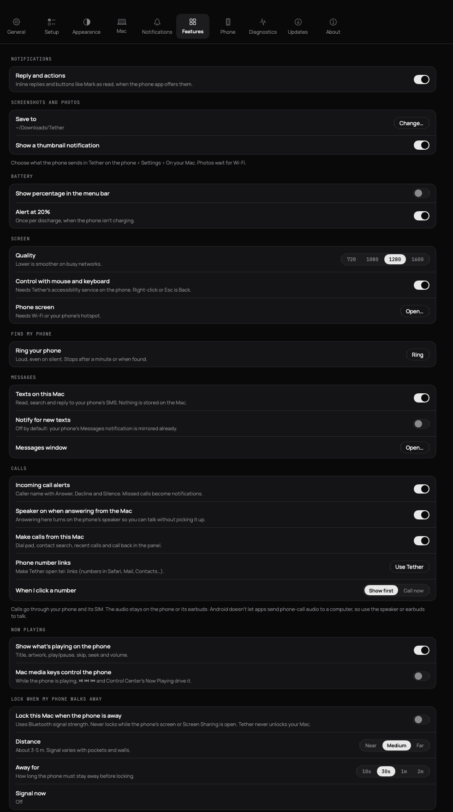

# Tether

**Your Android phone and your Mac, linked directly.** Notifications you can answer, clipboard, files, screenshots, battery, find-my-phone and screen control, over Bluetooth LE with a Wi-Fi fast path. End-to-end encrypted. No server, no account, no cloud.

<p>
  
  
  
</p>

**Download v0.2.0:** [Mac (.dmg)](https://github.com/Benfranklinms/Tether/releases/download/v0.2.0/Tether-0.2.0.dmg) · [Mac (.zip)](https://github.com/Benfranklinms/Tether/releases/download/v0.2.0/Tether-0.2.0.zip) · [Android (.apk)](https://github.com/Benfranklinms/Tether/releases/download/v0.2.0/Tether-0.2.0.apk) · [all releases](https://github.com/Benfranklinms/Tether/releases)

macOS 13+ (Apple silicon and Intel) · Android 8.0+ · MIT licensed

---

## Contents

[Features](#features) · [Install](#install) · [Pair](#pair) · [Feature setup and permissions](#feature-setup-and-permissions) · [Bluetooth vs Wi-Fi](#bluetooth-vs-wi-fi) · [Security](#security) · [Troubleshooting](#troubleshooting) · [Architecture](#architecture) · [Build from source](#build-from-source) · [Limitations](#limitations) · [Credits](#credits-and-license)

## Features

| | What it does |
|---|---|
| **Notifications** | Phone notifications appear on the Mac (per-app rules on both sides, quiet hours, muted words, hide contents). Dismiss on one, it clears on the other. |
| **Reply from the Mac** *(0.2)* | Inline reply for any app that offers one in its notification (WhatsApp, Messages, Telegram, Signal, Slack, Gmail…), from the banner or the menu. Other buttons such as *Mark as read* show up too. |
| **Clipboard** | Copy on the Mac, paste on the phone. Phone → Mac from the quick tile, share sheet or app. Password-manager items are skipped. |
| **Files** | Share sheet → Tether, or drag onto the menu. Resumable, SHA-256 verified, up to 4 GB on Wi-Fi. |
| **Screenshots and photos** *(0.2)* | New screenshots (on by default) and camera photos (off by default) go to the Mac automatically, with a thumbnail notification and a draggable recent strip. Photos wait for Wi-Fi. Never the old gallery, never twice. |
| **Phone battery** *(0.2)* | Level, charging and network in the menu (optionally the % in the menu bar), with a Mac alert at 20 %. |
| **Find my phone** *(0.2)* | The phone rings at full alarm volume, even on silent, with a full-screen Stop. Stops after 60 s or from the Mac. |
| **Phone screen** *(0.2)* | See the phone's screen in a resizable Mac window (hardware H.264, adaptive bitrate) and control it: click, long-press, drag, scroll, type, Back/Home/Recents. Needs Wi-Fi. |
| **Appearance** *(0.2)* | Pure Mono (solid black and greys) or Liquid Glass (real macOS 26 glass, monochrome; translucent vibrancy on macOS 13–15). Follows Reduce Motion and Reduce Transparency. |

## Install

### Mac

1. Download `Tether-0.2.0.dmg` (or the `.zip`), open it and drag **Tether** to **Applications**.
2. Tether is **ad-hoc signed and not notarized** (no paid Apple Developer account), so the first open is blocked:
   - **Right-click** Tether in Applications → **Open** → **Open**.
   - macOS 15 Sequoia and later: open it once, then **System Settings › Privacy & Security** → **Open Anyway**.
   - Or in Terminal: `xattr -dr com.apple.quarantine /Applications/Tether.app`
3. Allow **Bluetooth** when asked (required) and **Notifications** (to show your phone's notifications). On macOS 15+, allow **Local Network** for the Wi-Fi fast path.
4. Tether lives in the menu bar (two rings); no Dock icon. **Updating** from 0.1.x: replace the app; you stay paired.

Liquid Glass needs **macOS 26 Tahoe**. On older macOS the Liquid Glass option uses translucent vibrancy instead.

### Android

1. Download `Tether-0.2.0.apk` on the phone and open it. Allow *Install unknown apps* for your browser or file manager.
2. **Play Protect** may warn about an app from an unknown developer: tap **More details → Install anyway**. Tether has no internet servers; the APK is built in public CI from this repository.
3. Open Tether and follow the setup. Updating from 0.1.x installs over it (same signing key) and keeps the pairing.
4. **Allow restricted settings** (Android 13+, sideloaded apps): before Android lets you turn on **Notification access** or **Accessibility** for Tether, go to **Settings › Apps › Tether › ⋮ (top right) › Allow restricted settings**, confirm, then enable the access. You only do this once.

## Pair

1. On the Mac: menu-bar icon → **Pair a phone**. A QR code appears.
2. On the phone: **Scan code** and point it at the Mac. Done in one tap.
   - No camera? **Pair without camera**: both screens show a 6-digit code; confirm on both if they match.
3. Keep the phone within Bluetooth range. Tether reconnects by itself.

Both pairing screens show a live status line and explain failures. See [Troubleshooting](#troubleshooting).

## Feature setup and permissions

Everything new is on the phone in **Tether › Settings › On your Mac**, and on the Mac in **Settings › Features**. Permission rows appear only while something is missing.

| Feature | Phone permission | Mac permission | Notes |
|---|---|---|---|
| Link (required) | Nearby devices (Bluetooth); Location on Android ≤ 11 | Bluetooth | Allow battery "Unrestricted" on the phone for reliable background links |
| Notifications | Notification access (*restricted setting*) | Notifications | |
| Reply and actions | Notification access | Notifications | Works when the app's notification has an inline reply |
| Screenshots / photos | Photos (`READ_MEDIA_IMAGES`; choose **Allow all**) | — | Saved to `~/Downloads/Tether` (Mac Settings › Features to change) |
| Battery | — (optional *Phone* permission adds 4G/5G) | Notifications for the 20 % alert | |
| Find my phone | Notifications; **Full-screen alerts** recommended (Android 14+) | — | Uses the alarm stream: rings in silent/vibrate; most phones let alarms through Do Not Disturb |
| Screen view | Android asks **every session** (*Start now*) | — | Needs Wi-Fi or hotspot |
| Screen control | **Accessibility › Tether screen control** (*restricted setting*) | — | Without it the Mac can view but not control |
| Files, clipboard | Notifications (progress); Camera only for QR pairing | Local Network (macOS 15+) for Wi-Fi | |

**Screen sharing, step by step:** Mac menu → **Phone screen** → on the phone tap the *Your Mac wants to see this screen* notification (or it opens directly if Tether is on screen) → **Start now**. A *Sharing your screen* notification with **Stop** stays while it runs. In the Mac window: click = tap, hold = long-press, drag = swipe, two-finger scroll = scroll, type into the focused field, ⌘V pastes, Return = enter, Esc or right-click = Back.

## Bluetooth vs Wi-Fi

- **Bluetooth LE** is always on: pairing, notifications, replies, clipboard, battery, ring, and files up to 100 MB (about 30–100 KB/s).
- **Wi-Fi fast path**: when both are on the same network, or the **Mac is on the phone's hotspot**, Tether opens a direct TCP link (still Noise-encrypted, never via the internet). Big files, photos and the **screen stream** use it. If it drops, transfers continue over Bluetooth from the last verified byte.
- Many campus, office and guest networks block device-to-device traffic. If the Wi-Fi chip never appears, turn on the phone's **hotspot** and join it from the Mac.

## Security

- **Noise `XX_25519_ChaChaPoly_SHA256`** on both links (different prologues, so a Bluetooth handshake can't be replayed on Wi-Fi). One X25519 key per install: Android Keystore-wrapped on the phone, a 0600 file on the Mac.
- **Pairing** by QR (Mac key + one-time token, checked in the handshake) or 6-digit code comparison. Wi-Fi sessions only accept the paired key plus a single-use token offered over Bluetooth.
- **Key rotation** from Settings; **unpair** on either side forgets on both.
- **No servers, no account, no analytics.** Logs record events and sizes only: never clipboard text, notification content, file names or screen content.
- Screen control acts only while you are sharing your screen, only on input from the paired Mac, and the accessibility service does not read or keep screen content.

Wire protocol: [docs/PROTOCOL.md](docs/PROTOCOL.md).

## Troubleshooting

| Symptom | Try |
|---|---|
| Mac says Bluetooth is off / not allowed | Turn Bluetooth on; enable Tether in System Settings › Privacy & Security › Bluetooth; reopen Tether |
| Phone can't find the Mac | Keep the Mac's pairing window open, stay within a few metres; on some phones turn on Location; check *Nearby devices* |
| Pairing stalls at "securing the link" | Close and reopen the Mac pairing window, try again; then export diagnostics on both |
| Can't enable Notification access / Accessibility ("Restricted setting") | Settings › Apps › Tether › ⋮ › **Allow restricted settings**, then enable |
| Reply button missing on the Mac | The phone app's notification has no inline reply (e.g. some bank or system apps), or Reply is off in either app's Features |
| Screenshots don't arrive | Phone: Settings › On your Mac › Send new screenshots on, Photos permission **Allow all**; the phone sends only screenshots taken after you turned it on |
| Photos stay "Waiting for Wi-Fi" | Expected on Bluetooth: join the same Wi-Fi or the phone's hotspot |
| Screen says "needs Wi-Fi" | Same as above; screen video never goes over Bluetooth |
| Screen shows but clicks do nothing | Enable *Tether screen control* in phone Accessibility settings (allow restricted settings first) and *Control with mouse and keyboard* on the Mac |
| Phone doesn't ring loudly in Do Not Disturb | Allow alarms in your DND settings; allow Tether full-screen alerts |
| Link drops in the background | Phone: Tether › Settings › Battery optimization → Unrestricted (OnePlus/Oppo: also allow background activity) |
| Anything else | **Export diagnostics**: phone Settings › Export logs; Mac Settings › Diagnostics › Export… (no personal content) |

## Architecture

```
Android (Kotlin, Compose)                         macOS (Swift, SwiftUI)
┌──────────────────────────────┐                  ┌──────────────────────────────┐
│ App: BLE central, NotificationListener,         │ App: CoreBluetooth peripheral,│
│ MediaStore watcher, battery, ringer,            │ UserNotifications, Bonjour,   │
│ MediaProjection + MediaCodec, accessibility     │ VideoToolbox screen viewer    │
├──────────────────────────────┤                  ├──────────────────────────────┤
│ android/core (pure JVM)      │  same protocol   │ mac/TetherCore (Swift pkg)   │
│ Noise XX · framing · messages│◄───────────────►│ Noise XX · framing · messages │
│ controller · transfers       │  shared vectors  │ controller · transfers       │
└──────────────────────────────┘  + interop test  └──────────────────────────────┘
          Bluetooth LE (GATT, fragments)  ·  Wi-Fi TCP (length-prefixed records)
```

The protocol is implemented twice, independently, and cross-checked: shared JSON test vectors, Noise test vectors, and an **interop harness** that runs the real Kotlin phone core against the real Swift Mac core over a pipe (pairing, every message type in both directions, a Wi-Fi session, media transfers, split H.264 frames, input mapping, old and future peers).

```
android/core      Kotlin protocol core + tests (incl. InteropTest)
android/app       Android app (Compose) + Robolectric tests and screenshots
mac/TetherCore    Swift protocol core (Swift package) + tests
mac/Tether        Mac menu-bar app (SwiftUI)
tools/interop     Swift peer for the Kotlin ↔ Swift interop test
protocol/vectors  Shared test vectors
docs/PROTOCOL.md  Wire protocol
```

## Build from source

```sh
# Android (JDK 17)
cd android && ./gradlew detekt :core:test :app:testDebugUnitTest :app:lintDebug :app:assembleRelease

# Mac (Xcode 26 for Liquid Glass; Xcode 15+ builds with the fallback). brew install xcodegen swiftlint
cd mac && swiftlint lint --strict && (cd TetherCore && swift test)
xcodegen generate && open Tether.xcodeproj

# Interop: Kotlin phone core ↔ Swift Mac core
(cd tools/interop && swift build)
cd android && TETHER_SWIFT_PEER=$PWD/../tools/interop/.build/debug/tether-peer ./gradlew :core:test --tests '*InteropTest*'
```

**CI** (`.github/workflows/ci.yml`) runs on every push: detekt, core + Robolectric tests, Android lint, R8 release build and screenshots; the interop job (Ubuntu, Swift + JDK); SwiftLint, TetherCore tests and a universal Release build of the Mac app on macOS (checks Liquid Glass is linked), ad-hoc signed and packaged; demo-mode screenshots. A `v*` tag publishes the release with `Tether-<version>.apk`, `.dmg` and `.zip`.

**Signing.** `android/keystore/tether.jks` (password `tetherdebug`) is committed on purpose so every build installs over the previous one. It protects nothing: if you distribute a fork, use your own key. Try the Mac UI without a phone: `/Applications/Tether.app/Contents/MacOS/Tether --demo`.

## Limitations

- **Tested on real hardware only for 0.1.x** (pairing and notification mirroring on a MacBook Air + OnePlus Nord CE5). The 0.2 features are covered by unit, interop and build tests in CI but have not yet run on a real phone and Mac.
- **Replies** work only where the phone app's notification offers an inline reply (RemoteInput). Some apps hide it on the lock screen or for certain chats; SMS apps vary. Tether can't start new conversations.
- **Screen sharing** needs Wi-Fi/hotspot. Android requires consent every session and shows its own capture indicator. Apps that set `FLAG_SECURE` (banking, some video apps, password fields) appear black. Latency target is under ~150 ms on a good network; busy Wi-Fi lowers quality first. Long-press and drags are sent when you release the mouse, not live. Typing uses accessibility text replacement: it works in normal text fields, not in games or custom keyboards' own fields.
- **Find my phone** can't override a phone with alarm volume locked by the OEM or a DND mode that blocks alarms; full-screen alerts may need permission on Android 14+.
- **Auto media** sends screenshots/camera photos taken after you enable it; edited copies are sent again only if their bytes differ. Android's "limited photo access" hides new photos from Tether; choose *Allow all*.
- **Background**: aggressive OEM battery management can still stop the link; set Tether's battery use to Unrestricted.
- **One phone, one Mac.** Not notarized; the APK key is public (see Signing). Android 10+ blocks background clipboard reads, so phone → Mac clipboard is manual (tile, share sheet or app).

## Credits and license

Tether is released under the [MIT License](LICENSE).

- The Bluetooth fragment framing and the Noise XX structure are adapted from [bitchat](https://github.com/permissionlesstech/bitchat) (Swift, released into the public domain under the Unlicense). Thank you to its authors. The Android implementation was written independently against the Noise specification and test vectors; no bitchat-android (GPL-3.0) code is used.
- [Manrope](https://github.com/sharanda/manrope) typeface, SIL Open Font License 1.1.
- Bouncy Castle (MIT-style), ZXing and zxing-android-embedded (Apache 2.0), AndroidX / Jetpack Compose (Apache 2.0).
