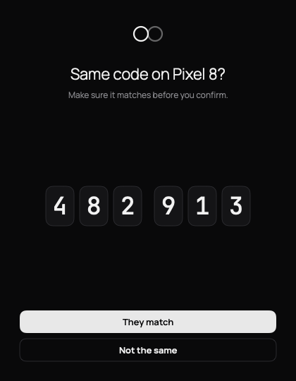

# Tether

Your Android phone and your Mac, linked directly. Clipboard, notifications and files over Bluetooth LE, with a Wi-Fi fast path for big files. End-to-end encrypted (Noise XX), no server, no account, no cloud.

<p>
  
  
  
</p>

> **Status: v0.1.0, built and tested in CI only.** The protocol cores have unit tests on both platforms (shared test vectors, Noise test vectors, real TCP loopback), and both apps compile and render in CI. **Neither app has been run on a real phone or Mac yet.** Expect rough edges, especially in the Bluetooth layer. See [Limitations](#limitations).

## What it does

| | Phone → Mac | Mac → Phone |
|---|---|---|
| Clipboard | Copy on the phone (quick tile or share sheet), paste on the Mac | Copy on the Mac, paste on the phone (automatic) |
| Notifications | Mirrored as macOS notifications, with per-app rules on both sides | Dismissing on the Mac clears it on the phone |
| Files | Share sheet → Tether | Drag onto the menu, or "Send file…" |

- **Bluetooth LE** keeps the two linked in the background at low power. Files up to 100 MB go over Bluetooth; transfers resume after a disconnect and are SHA-256 verified.
- **Wi-Fi fast path:** when both are on the same Wi-Fi (or the Mac is on the phone's hotspot), clipboard and files switch to a direct TCP link, still end-to-end encrypted. Files above 100 MB wait for Wi-Fi.
- **Notification controls:** on the phone, per-app allow/block, muted keywords, quiet hours, hide contents, only while locked. On the Mac, per-app show/hide and banner/silent, privacy mode, history size. macOS Focus applies.
- **Security:** Noise `XX_25519_ChaChaPoly_SHA256`, pairing by 6-digit code comparison or QR, key rotation, one paired phone at a time. Logs never contain clipboard text, notification content or file names. See [docs/PROTOCOL.md](docs/PROTOCOL.md).

## Install

Download from the [latest release](https://github.com/Benfranklinms/Tether/releases/latest).

### Mac (macOS 13 Ventura or later, Apple silicon and Intel)

1. Open `Tether-<version>.dmg` and drag **Tether** to **Applications** (or unzip `Tether-<version>.zip`).
2. The app is **ad-hoc signed and not notarized** (no paid Apple Developer account), so Gatekeeper blocks a plain double-click the first time. Either:
   - **Right-click** (or Control-click) Tether in Applications → **Open** → **Open**. On macOS 15 Sequoia, if there is no Open button: try to open it once, then go to **System Settings → Privacy & Security** and click **Open Anyway**.
   - Or in Terminal: `xattr -dr com.apple.quarantine /Applications/Tether.app`
3. Tether lives in the menu bar (two rings). It has no Dock icon.

### Android (8.0 or later)

1. Download `Tether-<version>.apk` on the phone and open it. Allow "Install unknown apps" for your browser or file manager when asked.
2. Open Tether and follow the setup.

## Pair

1. On the Mac, click the menu-bar icon → **Pair a phone**. A QR code appears.
2. On the phone, tap **Scan code** and point it at the Mac. Done in one tap.
   - No camera? Tap **Pair without camera**. Both screens show a 6-digit code; confirm on both if they match.
3. Keep the phone within Bluetooth range. Tether reconnects by itself.

### If pairing doesn't finish

Both pairing screens show a live status line ("Visible over Bluetooth · waiting for your phone", "Found your Mac · connecting", "securing the link…") and, when something fails, say why.

- **Mac says Bluetooth is off or not allowed:** turn Bluetooth on, or enable Tether in System Settings › Privacy & Security › Bluetooth, then reopen Tether.
- **Phone says it couldn't find your Mac:** keep the Mac's pairing window open (it is what makes the Mac visible), keep the devices within a few metres, and if the phone heard no Bluetooth signals at all, turn on Location (some phones need it to scan).
- **Still stuck:** tap **Export diagnostics** on the phone's pairing screen and on the Mac's (or Settings › Diagnostics). The logs hold connection events only, never content.

## Permissions

**Android**
- **Nearby devices** (Bluetooth): required, to find and stay connected to the Mac. On Android 11 and older this is shown as Location; Tether doesn't use your location.
- **Notifications:** for the connection and transfer status.
- **Notification access:** only if you want notifications mirrored to the Mac.
- **Camera:** only for QR pairing.
- **Battery:** allow Tether to run unrestricted so Android doesn't cut the link in the background (Settings → Battery in the app).

**Mac**
- **Bluetooth:** required (asked on first launch).
- **Notifications:** to show your phone's notifications.
- **Local Network** (macOS 15+): for the Wi-Fi fast path.
- **Open at login:** optional, in Settings → General.

## Try the Mac app without a phone

```sh
/Applications/Tether.app/Contents/MacOS/Tether --demo
```

runs it with sample data and no radios. `--screenshots <dir>` renders every screen to PNGs and quits (CI uses this for the images in this README).

## Limitations

- **Untested on real devices.** Everything here is verified by unit tests and CI builds only. The Bluetooth GATT behaviour, background survival on aggressive OEM ROMs, macOS permission prompts and the Wi-Fi handover have not been exercised on hardware yet.
- **One phone, one Mac.** Pairing a new phone replaces the old one.
- **Not notarized** (see Install). The Android APK is signed with a key that is committed to this repo (see below).
- **Clipboard is text only** (up to 64 KB over Bluetooth, 1 MB over Wi-Fi). Images and files go through file transfer.
- **Android 10+ restricts background clipboard reads**, so phone → Mac clipboard is sent from the quick-settings tile, the share sheet or the app, not automatically on every copy.
- **No replies** to notifications from the Mac, and no SMS or calls.
- **Wi-Fi fast path** needs the two devices on the same network (or the Mac on the phone's hotspot) and networks that allow device-to-device traffic. Many campus and guest networks block it; Bluetooth still works.
- Mac → phone transfers save to the phone's Downloads/Tether (or a folder you pick).

## Build

```sh
# Android (JDK 17): debug + release APK, unit tests, Robolectric screenshots
cd android && ./gradlew :core:test :app:testDebugUnitTest :app:assembleRelease

# Mac (Xcode 15+, brew install xcodegen swiftlint)
cd mac && swiftlint lint --strict
(cd TetherCore && swift test)
xcodegen generate && open Tether.xcodeproj
```

CI (`.github/workflows/ci.yml`) runs detekt, unit + Robolectric tests, Android lint and an R8 release build; SwiftLint, the TetherCore tests and a universal Release build of the Mac app, ad-hoc signed and packaged as `.zip` and `.dmg`; and demo-mode screenshots for both. Pushing a `v*` tag publishes a GitHub release with `Tether-<version>.apk`, `.dmg` and `.zip`.

### Signing

`android/keystore/tether.jks` (password `tetherdebug`) is **committed on purpose** so every CI build is signed with the same key and installs over the previous one. It is not a secret and offers no protection against someone else building an APK with the same signature. If you fork Tether and distribute it, generate your own key and keep it private.

## Project layout

```
android/core     Kotlin protocol core (JVM, no Android deps) + tests
android/app      Android app (Compose)
mac/TetherCore   Swift protocol core (Swift package) + tests
mac/Tether       Mac menu-bar app (SwiftUI)
protocol/vectors Shared test vectors used by both cores
docs/PROTOCOL.md Wire protocol
```

## Credits and license

Tether is released under the [MIT License](LICENSE).

- The Bluetooth fragment framing and the Noise XX structure are adapted from [bitchat](https://github.com/permissionlesstech/bitchat) (Swift, public domain / Unlicense). Thank you to its authors. The Android implementation was written independently against the Noise specification and test vectors; no bitchat-android (GPL-3.0) code is used.
- [Manrope](https://github.com/sharanda/manrope) typeface, SIL Open Font License 1.1.
- Bouncy Castle (MIT-style), ZXing (Apache 2.0), AndroidX/Jetpack Compose (Apache 2.0).
