<div align="center">


# Tether

**Your Android phone and your Mac, linked directly. No cloud, no account.**

[](https://github.com/Benfranklinms/Tether/actions/workflows/ci.yml)
[](https://github.com/Benfranklinms/Tether/releases/latest)
[](#requirements)
[](LICENSE)

[Download](#installation) · [Features](#features) · [How it works](#how-it-works) · [Setup](#first-time-setup-and-permissions) · [Privacy](#privacy-and-security) · [Build](#building-from-source) · [Protocol](docs/PROTOCOL.md)

</div>

<p align="center">
  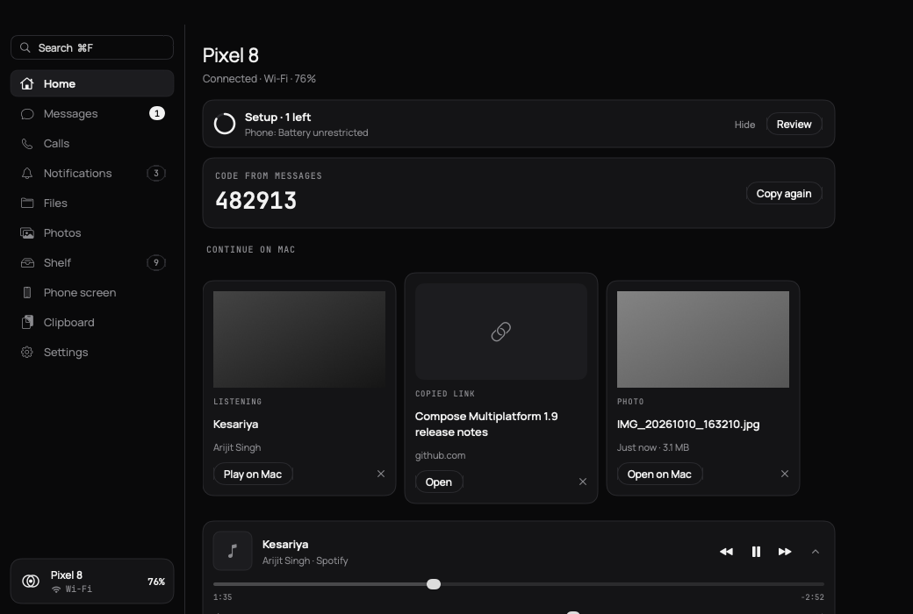
  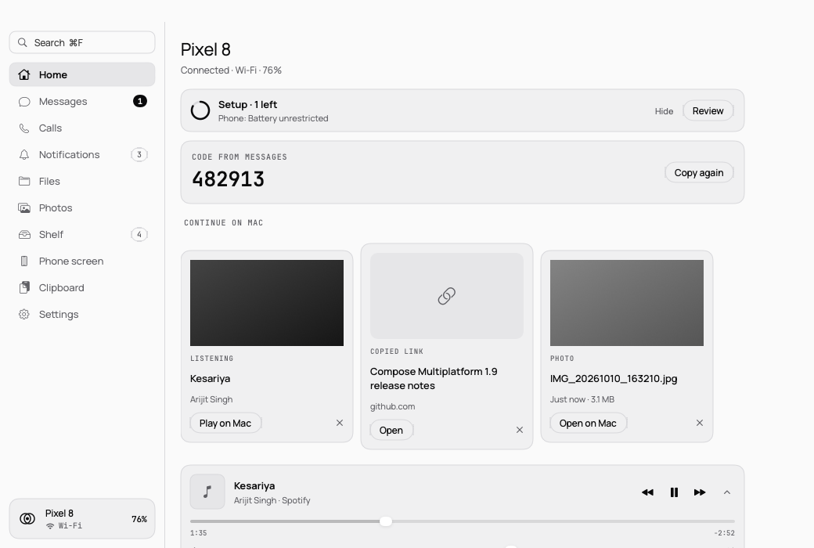
</p>

Tether brings your Android phone to your Mac: texts, calls, notifications you can reply to, your phone's files and photos, one-time codes on the clipboard, clipboard sync, media controls and screen mirroring. The two devices talk to each other over Bluetooth LE, with a direct Wi-Fi fast path when they share a network, end-to-end encrypted with the Noise protocol. Nothing goes through a server.

## Contents

- [What's new in 0.5.1](#whats-new-in-051)
- [Screenshots](#screenshots)
- [Features](#features)
- [How it works](#how-it-works)
- [Requirements](#requirements)
- [Installation](#installation)
- [First-time setup and permissions](#first-time-setup-and-permissions)
- [In-app updates](#in-app-updates)
- [Privacy and security](#privacy-and-security)
- [Limitations](#limitations)
- [Troubleshooting](#troubleshooting)
- [Building from source](#building-from-source)
- [Project structure](#project-structure)
- [Contributing](#contributing)
- [Credits](#credits)
- [License](#license)

## What's new in 0.5.1

- **Clipboard images work both ways.** Copying an image (including an image file in Finder, or a photo in a gallery app) sends the picture, not its file name.
- **Type on your phone** now shows whether Tether control is on, with a **Fix** button that opens the setting on the phone, and reports every keystroke batch that doesn't land.
- **Calls float above everything**: an incoming call shows a banner at the top right with Answer, Decline and Silence, then a small live-call bar.
- **Photos is a proper gallery** with albums, date sections, filters, multi-select and a zooming viewer; **Files** has a grid view.
- **Setup is quieter**: Home shows one slim "Setup · n left" row only while something required is missing.
- Text never wraps mid-word or squeezes row titles, at any text size; more (and smoother) animation, all of it off with Reduce Motion.

Every release's changes, including what's coming in 0.5.2, are in [CHANGELOG.md](CHANGELOG.md).

## Screenshots

<table>
  <tr>
    <td width="66%">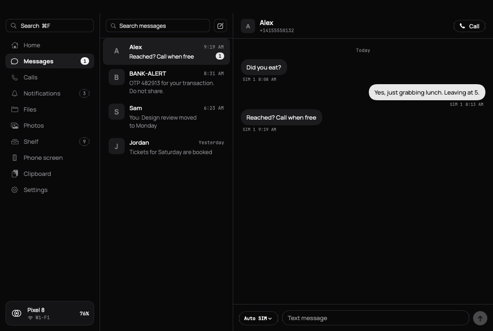</td>
    <td width="34%">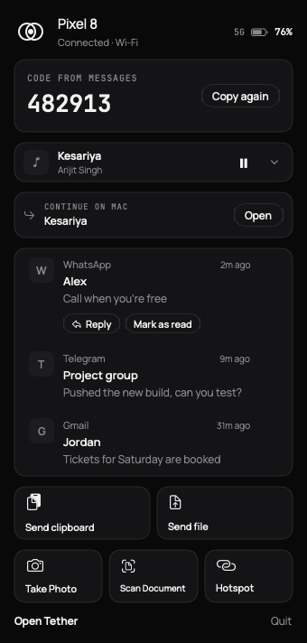</td>
  </tr>
  <tr>
    <td align="center"><sub>Messages, with search and reply</sub></td>
    <td align="center"><sub>Menu-bar popover</sub></td>
  </tr>
  <tr>
    <td>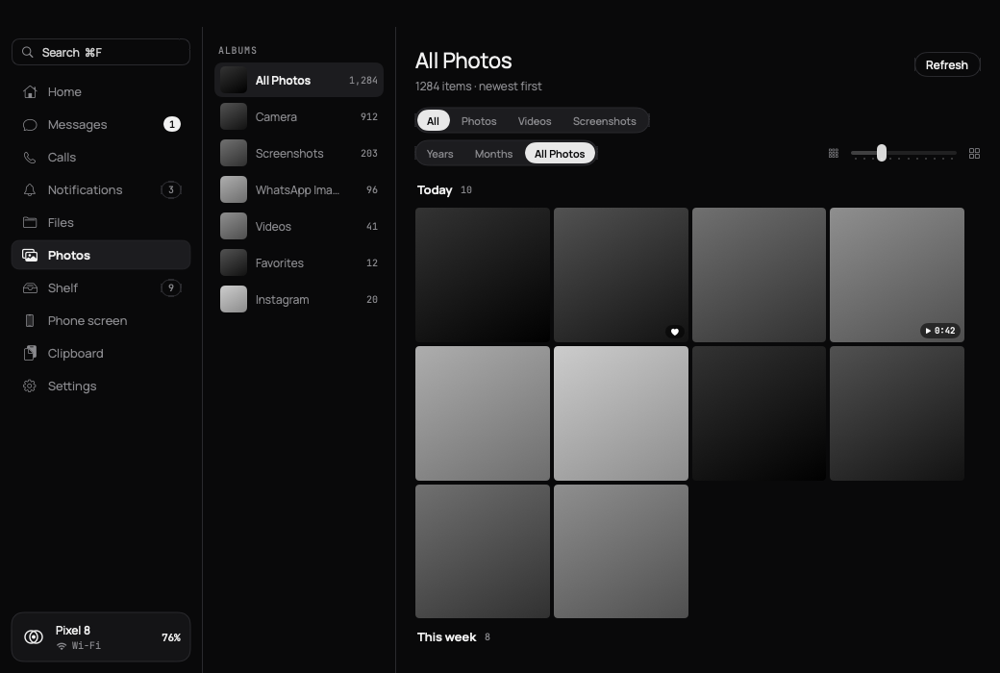</td>
    <td>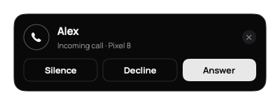</td>
  </tr>
  <tr>
    <td align="center"><sub>Photos, with albums and date sections</sub></td>
    <td align="center"><sub>Incoming call banner</sub></td>
  </tr>
  <tr>
    <td>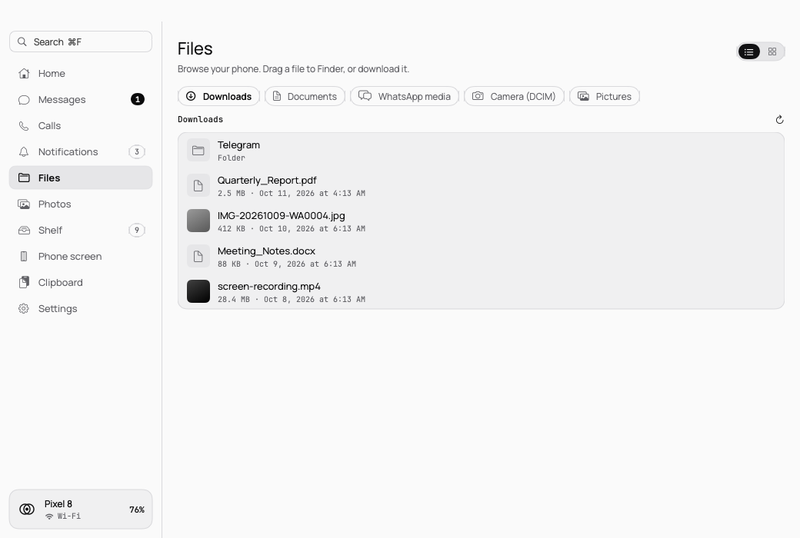</td>
    <td>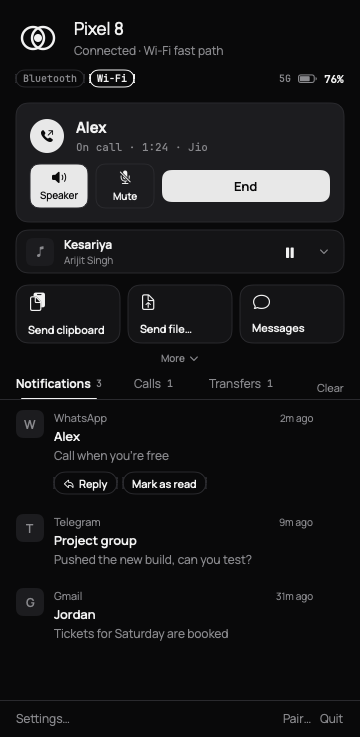</td>
  </tr>
  <tr>
    <td align="center"><sub>The phone's files, in Light mode</sub></td>
    <td align="center"><sub>Call controls</sub></td>
  </tr>
  <tr>
    <td>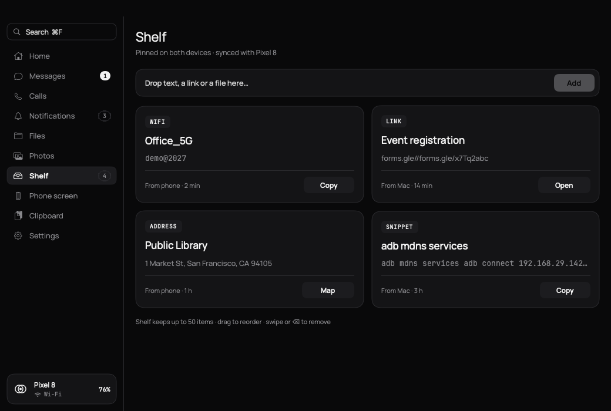</td>
    <td></td>
  </tr>
  <tr>
    <td align="center"><sub>Shelf, shared by both devices</sub></td>
    <td align="center"><sub>Insert from Phone</sub></td>
  </tr>
  <tr>
    <td>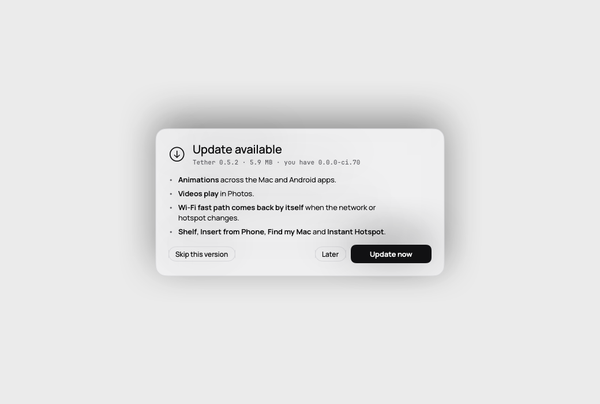</td>
    <td>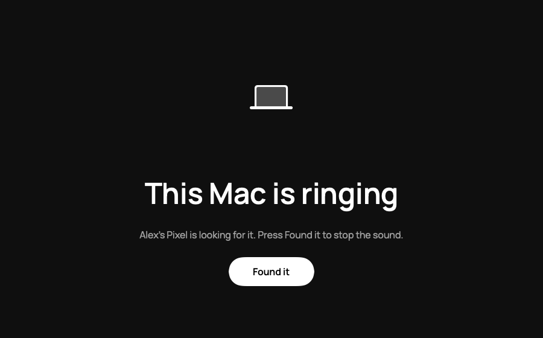</td>
  </tr>
  <tr>
    <td align="center"><sub>Update popup, in Light mode</sub></td>
    <td align="center"><sub>Find my Mac</sub></td>
  </tr>
</table>

<p align="center">
  
  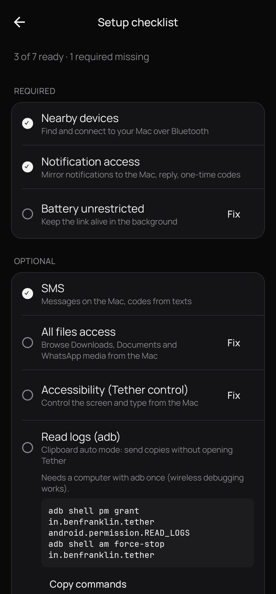
  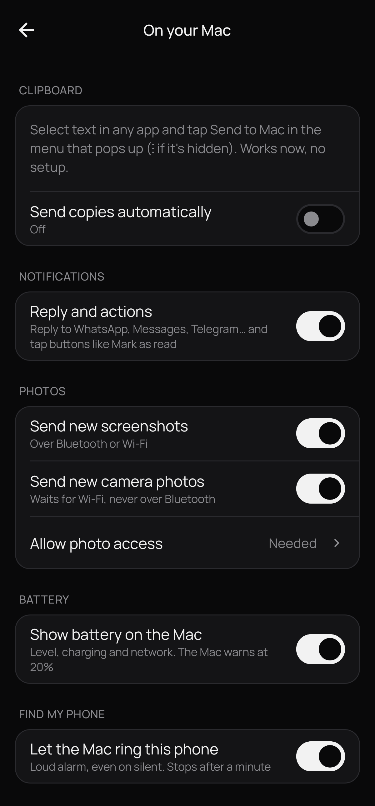
  
</p>

All screenshots are generated by CI from demo data on every build ([`docs/screenshots`](docs/screenshots)).

## Features

### Communication

| Feature | Description |
|---|---|
| **Messages** | Your phone's SMS conversations in a Mac window: unread counts, full threads, search across every message, reply or start a new text, SIM choice on dual-SIM phones, live delivery status. Nothing is stored on the Mac. |
| **Calls** | Place calls from the Mac (dial pad, contact search, recent calls, phone-number links). Answer, decline or silence incoming calls; end, speaker and mute during a call. The call and its audio stay on the phone. |
| **Notifications** | Phone notifications on the Mac with per-app rules, quiet hours and muted words. Dismissing on one device clears it on the other. |
| **Reply from the Mac** | Inline reply and action buttons for any app whose notification offers them (WhatsApp, Telegram, Signal, Slack, Gmail and more). |
| **One-time codes** | Verification codes from texts and notifications are copied to the Mac clipboard automatically. |

### Files, photos and clipboard

| Feature | Description |
|---|---|
| **Phone files** | Browse Downloads, Documents, WhatsApp media, DCIM and Pictures as a list or a thumbnail grid; preview, download, open, or drag straight into Finder. |
| **Photos** | A real gallery of the phone's camera roll: albums (Camera, Screenshots, WhatsApp, Videos, Favorites and every other folder), date sections, Years / Months / All Photos, filters, a size slider (⌘+ / ⌘−), multi-select, and a viewer with arrow keys and photo details. Videos play right in the viewer, fetched over Wi-Fi (Bluetooth when that's all there is). New screenshots (and optionally camera photos) arrive automatically. |
| **File transfer** | Share sheet, Finder Share extension, Dock-icon drop or drag onto the window. Resumable, SHA-256 verified, up to 4 GB over Wi-Fi. |
| **Clipboard** | Copy on one device, paste on the other, text and images. History of the last 20 items. Password-manager items are skipped. |
| **Shelf** | A pinned list shared by both devices: text, links, Wi-Fi networks (password hidden until you ask), addresses, code snippets and files. Add from either side, from the clipboard history or the Share menu; drag to reorder. Up to 50 items; a file's bytes stay on the device that added it until the other one opens it. |
| **Insert from Phone** | *Take Photo* or *Scan Document* on the Mac opens the phone's camera or document scanner; the result is pasted into the app you were using (or saved to the Desktop and copied when Tether may not paste). |
| **Continue on Mac** | A new photo, a finished download, a copied or shared link, the song that is playing or the current browser tab appear as cards with one click to open them on the Mac. |
| **Open on phone** | Send a link or text from any Mac app (Services menu, Share menu or `tether://send`) to open on the phone. |

### Control

| Feature | Description |
|---|---|
| **Phone screen** | Mirror the phone in a resizable Mac window (hardware H.264, adaptive bitrate) and control it with mouse and keyboard. |
| **Type on the phone** | Use the Mac keyboard to type into the phone's focused text field. |
| **Now playing** | Artwork, progress, play/pause, skip, seek and phone volume; optionally driven by the Mac's media keys. |
| **Find my phone** | Rings the phone at full alarm volume, even on silent. |
| **Find my Mac** | From the phone: ring the Mac with a loud chime and a full-screen *Found it* on every display, or lock it. |
| **Instant Hotspot** | Best effort: one click on the Mac asks the phone to turn on its hotspot, then joins it. Needs the hotspot name and password saved once in Tether on the phone and Tether control (accessibility) on, so the phone can flip the switch; where the switch can't be found, the phone opens its hotspot settings instead. |
| **Battery** | Phone battery and network in the app and menu bar, with low-battery and fully-charged alerts. |
| **Focus and Do Not Disturb** | Keeps Mac Focus and phone Do Not Disturb in step (through Shortcuts on the Mac). |
| **Calls and Mac audio** | Pauses or lowers Mac audio during a phone call and restores it afterwards. |
| **Lock when away** | Optional: locks the Mac when the phone's Bluetooth signal moves out of range. |
| **Proximity unlock** | Optional and off by default: types the Mac password (kept in the Keychain behind Touch ID) at the lock screen when the paired phone is near. |

### Mac app

| Feature | Description |
|---|---|
| **Windowed app** | Sidebar with Home, Messages, Calls, Notifications, Files, Photos, Shelf, Phone screen, Clipboard and Settings; remembers its size, position and page. |
| **Universal search** | <kbd>⌘</kbd><kbd>F</kbd> searches messages, calls and notifications at once. |
| **Menu-bar popover** | Battery, now playing, latest notifications, *Send clipboard* and *Send file*. Show Tether in the Dock, the menu bar, or both. |
| **Global shortcuts** | <kbd>⌥</kbd><kbd>⌘</kbd><kbd>V</kbd> send clipboard · <kbd>⌥</kbd><kbd>⌘</kbd><kbd>F</kbd> send a file · <kbd>⌥</kbd><kbd>⌘</kbd><kbd>T</kbd> open Tether. |
| **Widgets** | Phone battery and now playing (macOS 14+). |
| **Appearance** | Dark, Light or System, in Pure Mono or Liquid Glass (macOS 26; translucent vibrancy on earlier versions). Animated throughout (page transitions, hero transitions, zooming photos, cascading lists) in both apps; Reduce Motion turns it into fades, and Reduce Transparency is respected. |
| **Updates** | A popup when a new version is out, with its release notes and *Update now* / *Later* / *Skip this version*; a one-time *What's new* sheet after each update. |
| **Setup checklist** | On both devices: every permission a feature needs, with a *Fix* button per row. |

## How it works

```
Android (Kotlin, Jetpack Compose)                 macOS (Swift, SwiftUI)
┌──────────────────────────────┐                  ┌──────────────────────────────┐
│ BLE central, notification    │                  │ CoreBluetooth peripheral,    │
│ listener, SMS, telecom,      │                  │ notifications, Bonjour,      │
│ MediaStore, screen capture   │                  │ VideoToolbox, widgets        │
├──────────────────────────────┤                  ├──────────────────────────────┤
│ android/core (pure JVM)      │   same protocol  │ mac/TetherCore (Swift pkg)   │
│ Noise XX · framing · messages│◄────────────────►│ Noise XX · framing · messages│
│ controller · transfers       │  shared vectors  │ controller · transfers       │
└──────────────────────────────┘  + interop test  └──────────────────────────────┘
        Bluetooth LE (GATT, fragmented)   ·   Wi-Fi TCP (length-prefixed records)
```

- **Bluetooth LE is the always-on link.** Pairing, notifications, replies, texts, calls, now playing, clipboard, battery and small files travel over BLE GATT (roughly 30–100 KB/s).
- **Wi-Fi fast path.** When both devices share a network, or the Mac joins the phone's hotspot, Tether opens a direct TCP connection for large files, photos and the screen stream. It is negotiated over the encrypted Bluetooth link and falls back to Bluetooth from the last verified byte if it drops. When either device changes network (including turning on or joining the hotspot) the fast path re-negotiates by itself.
- **End-to-end encryption.** Both links use `Noise_XX_25519_ChaChaPoly_SHA256`, with different prologues so a Bluetooth handshake cannot be replayed over Wi-Fi.
- **No cloud.** There is no server, account or relay. Traffic never leaves your local radio range or network.
- **Two independent implementations.** The protocol is written once in Kotlin and once in Swift, cross-checked with shared test vectors and an interop harness that runs the real phone core against the real Mac core, including older released Mac versions.

The full wire format is documented in [docs/PROTOCOL.md](docs/PROTOCOL.md).

## Requirements

| | Minimum | Notes |
|---|---|---|
| **Mac** | macOS 13 Ventura | Apple silicon and Intel (universal). Widgets need macOS 14; Liquid Glass needs macOS 26. Bluetooth LE required. |
| **Android** | Android 8.0 (API 26) | Bluetooth LE required. Some features need Android 10+ or a one-time wireless-adb grant (see below). |
| **Network** *(optional)* | Same Wi-Fi network or the phone's hotspot | Needed for screen mirroring and fast transfers. Many guest and campus networks block device-to-device traffic; use the hotspot instead. |

## Installation

Download both apps from the [latest release](https://github.com/Benfranklinms/Tether/releases/latest).

| Platform | File |
|---|---|
| Android | `Tether-<version>.apk` |
| macOS | `Tether-<version>.dmg` or `Tether-<version>.zip` |

> [!IMPORTANT]
> **Upgrading from 0.4.x on Android:** version 0.5.0 is signed with a new release key, so it cannot install over 0.4.x. Uninstall the old Tether from the phone once, install 0.5.0, then pair again. Later updates install over 0.5.0 normally. The Mac app updates in place and keeps its settings.

### Android

1. Download the APK on the phone and open it. Allow **Install unknown apps** for your browser or file manager when asked.
2. If **Play Protect** warns about an unknown developer, choose **More details › Install anyway**. The APK is built by the public CI workflow in this repository.
3. **Android 13+:** sideloaded apps are blocked from some sensitive permissions until you allow them. Open **Settings › Apps › Tether › ⋮ › Allow restricted settings** once, then grant Notification access, Accessibility, SMS and Call log permissions.
4. Open Tether and follow the setup.

### macOS

1. Open the DMG (or unzip the ZIP) and drag **Tether** to **Applications**.
2. Tether is ad-hoc signed and **not notarized**, so Gatekeeper blocks the first launch. Either:
   - right-click Tether in Applications and choose **Open**, then **Open** again; on macOS 15 and later, open it once and then click **Open Anyway** in **System Settings › Privacy & Security**; or
   - remove the quarantine flag in Terminal:
     ```sh
     xattr -dr com.apple.quarantine /Applications/Tether.app
     ```
3. Allow **Bluetooth** (required), **Notifications**, and on macOS 15+ **Local Network** (for the Wi-Fi fast path).

### Pairing

1. On the Mac, choose **Pair a phone**. A QR code appears.
2. On the phone, tap **Scan code** and point the camera at the Mac.
   No camera? Choose **Pair without camera** and confirm that the 6-digit codes on both screens match.
3. Keep the phone within Bluetooth range. Tether reconnects on its own.

## First-time setup and permissions

Both apps include a **setup checklist** (Android: *Setup*; Mac: *Home* and *Settings*) listing each permission a feature needs, with a **Fix** button that opens the right settings screen. Every permission except Bluetooth is optional; a feature without its permission simply stays off.

| Feature | Android permission | Mac permission |
|---|---|---|
| Link (required) | Nearby devices (Bluetooth); Location on Android 11 and earlier. Battery usage *Unrestricted* recommended | Bluetooth |
| Notifications, reply, now playing | Notification access *(restricted)* | Notifications |
| Messages | SMS *(restricted)*, Phone, Contacts (optional, for names) | — |
| Calls | Phone, Call logs *(restricted)*, Contacts, Answer phone calls, Make and manage calls; Do Not Disturb access for *Silence* | Notifications; optionally Tether as the handler for phone links |
| Files browser | All files access | — |
| Photos, screenshots | Photos and videos (choose *Allow all*) | — |
| Phone screen control, typing | Accessibility › Tether screen control *(restricted)*; screen capture consent each session | — |
| Open on phone | Display over other apps (otherwise a tap-to-open notification) | — |
| Focus ↔ Do Not Disturb | Do Not Disturb access | Shortcuts named *Tether Focus On* / *Tether Focus Off* |
| Proximity unlock | — | Accessibility; password stored in the Keychain after Touch ID |
| In-app updates | Install unknown apps (for Tether) | — |

*Restricted* permissions require **Allow restricted settings** first on Android 13+ (see [Installation](#android)).

### Optional wireless-adb grants

Two features need a permission Android only grants over adb. This is a one-time step, done wirelessly from the Mac; the grants survive reboots and updates.

| Feature | Why |
|---|---|
| **One-time codes on Android 15+** | Android 15 hides codes in notifications from third-party apps ("Sensitive notification content hidden"). |
| **Clipboard auto mode** | Android 10+ only lets the foreground app read the clipboard. With log access Tether notices each copy and reads it automatically. Without it, use **Send to Mac** in the text-selection menu. |

1. On the phone, open **Settings › About phone** and tap **Build number** seven times to enable Developer options.
2. Connect phone and Mac to the same Wi-Fi network and turn on **Developer options › Wireless debugging**.
   On OnePlus, OPPO and realme phones also turn on **Disable permission monitoring**, or the grant is reverted.
3. Install the platform tools on the Mac and pair:
   ```sh
   brew install android-platform-tools
   adb pair <ip:port>       # from "Pair device with pairing code"; enter the 6-digit code
   adb connect <ip:port>    # the address shown on the Wireless debugging screen
   ```
4. Run the grants you need:
   ```sh
   # One-time codes on Android 15+ (restart the phone afterwards)
   adb shell cmd appops set --user 0 in.benfranklin.tether RECEIVE_SENSITIVE_NOTIFICATIONS allow

   # Clipboard auto mode
   adb shell pm grant in.benfranklin.tether android.permission.READ_LOGS
   adb shell appops set in.benfranklin.tether SYSTEM_ALERT_WINDOW allow
   adb shell am force-stop in.benfranklin.tether
   ```
5. For clipboard auto mode, open **Tether › Settings › On your Mac › Clipboard** and turn on **Send copies automatically**. On Android 13+, allow *access all device logs* when asked (Android asks again each time Tether's process restarts).

You can turn Wireless debugging off afterwards.

## In-app updates

Both apps can update themselves from this repository's GitHub releases (**Mac:** Settings › Updates; **Android:** Settings › Continue, files & updates). Each update is verified before it is installed:

| Check | Android | macOS |
|---|---|---|
| SHA-256 of the downloaded file | ✓ | ✓ |
| Package / bundle identifier | ✓ | ✓ |
| Newer version | ✓ (version code) | ✓ |
| Same signing certificate / valid code signature | ✓ | ✓ |
| Install | Android asks you to confirm | Replaces the app and relaunches |

A fine-grained, read-only GitHub token can optionally be saved on each device to raise GitHub's API rate limit. It is stored only on that device (Mac Keychain; Android Keystore-encrypted storage), sent only to `api.github.com`, and never logged. A custom HTTPS update feed can be configured instead of GitHub.

## Privacy and security

- **No servers, no account, no analytics.** Tether has no backend; data moves only between your two devices.
- **Encryption.** Noise XX (X25519, ChaCha20-Poly1305, SHA-256) on both Bluetooth and Wi-Fi. One identity key per install: Android Keystore-wrapped on the phone, a `0600` file on the Mac.
- **Pairing.** By QR code (Mac key plus a one-time token checked inside the handshake) or by comparing a 6-digit code. Wi-Fi sessions accept only the paired key plus a single-use token offered over Bluetooth. Keys can be rotated, and unpairing on either side forgets both.
- **Minimal retention.** Texts, call details and now-playing data are shown on the Mac only while connected and are never written to disk there.
- **Logs contain no content.** Diagnostics record events and sizes, never clipboard text, notification content, file names or screen content.
- **Screen control** acts only during a session you started, only on input from the paired Mac; the accessibility service does not read or store screen content.
- **Proximity unlock** is off by default, only types when the Mac is locked, the phone is near and the encrypted link is up, and is rate-limited.

Please report security issues privately through [GitHub security advisories](https://github.com/Benfranklinms/Tether/security/advisories/new) rather than public issues.

## Limitations

- **Call audio stays on the phone.** Android offers no API to route cellular audio to another device; use the phone's speaker or earbuds. Hold, merge and call waiting need the default dialer role, which Tether does not take. Some OEM dialers ignore Decline/End from other apps.
- **SMS only.** Tether is not the default SMS app, so it cannot mark messages read, delete them or send MMS. RCS chats do not appear in Messages (their notifications are still mirrored, with reply).
- **Replies** work only where the app's notification offers an inline reply.
- **Screen mirroring** needs Wi-Fi or a hotspot, asks for consent every session, and shows apps that block capture (banking, some video apps) as black.
- **Clipboard** from phone to Mac is manual unless auto mode is set up over adb; auto mode reads text only and cannot read while the phone is locked.
- **Proximity features** rely on Bluetooth signal strength, which is noisy; treat distances as approximate.
- **Background limits.** Aggressive OEM battery management can stop the link; set Tether's battery usage to *Unrestricted*.
- **Not notarized.** The Mac app is ad-hoc signed (see [Installation](#macos)).
- **One phone, one Mac** at a time.
- **Hardware coverage.** Every build runs unit, interop, emulator and UI tests in CI, but some features (proximity unlock, widgets, Finder drag of phone files, Focus sync, Share extension) can only be exercised on real hardware and have had limited real-device testing.

## Troubleshooting

| Symptom | What to try |
|---|---|
| Mac says Bluetooth is off or not allowed | Enable Tether in **System Settings › Privacy & Security › Bluetooth** and reopen it. |
| The phone can't find the Mac | Keep the Mac's pairing window open and stay within a few metres; check *Nearby devices* (and Location on older Android). |
| A permission toggle is greyed out | **Settings › Apps › Tether › ⋮ › Allow restricted settings**, then try again. |
| Stuck on *Looking nearby…* | Tap **Reconnect** on either device. Both apps also retry on their own with back-off. |
| Photos wait for Wi-Fi / screen needs Wi-Fi | Join the same network, or connect the Mac to the phone's hotspot. |
| Codes show as "Sensitive notification content hidden" | Run the one-time-codes grant in [Optional wireless-adb grants](#optional-wireless-adb-grants). |
| The link drops in the background | Set Tether's battery usage to *Unrestricted* (OnePlus/OPPO: also allow background activity). |
| Anything else | Export diagnostics (phone: Settings › Export logs; Mac: Settings › Diagnostics) and attach them to an issue. They contain no personal content. |

## Building from source

**Prerequisites:** JDK 17 and the Android SDK; Xcode 15+ (Xcode 26 for Liquid Glass), plus `brew install xcodegen swiftlint`.

```sh
# Android: static analysis, unit tests, lint, release build
cd android
./gradlew detekt :core:test :app:testDebugUnitTest :app:lintDebug :app:assembleRelease

# macOS: lint, core tests, Xcode project
cd mac
swiftlint lint --strict
(cd TetherCore && swift test)
xcodegen generate && open Tether.xcodeproj

# Interop: the Kotlin phone core against the Swift Mac core
(cd tools/interop && swift build)
cd android && TETHER_SWIFT_PEER=$PWD/../tools/interop/.build/debug/tether-peer \
  ./gradlew :core:test --tests '*InteropTest*'

# Instrumented tests (needs a running emulator with telephony)
cd android && bash scripts/emulator-tests.sh
```

Try the Mac interface without a phone: `/Applications/Tether.app/Contents/MacOS/Tether --demo`.

**Continuous integration.** [`.github/workflows/ci.yml`](.github/workflows/ci.yml) runs on every push and pull request: detekt, unit and Robolectric tests, Android lint, the R8 release build and Roborazzi screenshots; Kotlin ↔ Swift interop (including released Mac versions); emulator tests (notification reply, MediaStore, real calls through the emulator modem, clipboard auto mode, permission paths); and on macOS SwiftLint, core tests, a universal Release build with its widget and Share extensions, packaging and dark/light screenshots. Pushing a `v*` tag publishes a release with the APK, DMG and ZIP.

**Signing.** Release APKs are signed with Tether's release key, stored encrypted at `android/keystore/tether-release.p12.enc` and decrypted in CI with the `TETHER_STORE_PASSWORD` secret. Local and fork builds fall back to the standard Android debug key, so they cannot update an installed release build.

## Project structure

```
android/
  core/            Kotlin protocol core: Noise XX, framing, messages, controller, transfers (+ tests)
  app/             Android app (Jetpack Compose) with Robolectric, Roborazzi and instrumented tests
  scripts/         Emulator test driver
mac/
  TetherCore/      Swift protocol core as a Swift package (+ tests)
  Tether/          macOS app (SwiftUI)
  TetherWidgets/   WidgetKit extension
  TetherShare/     Finder Share extension
  project.yml      XcodeGen project definition
tools/interop/     Swift peer used by the Kotlin ↔ Swift interop test
protocol/vectors/  Shared JSON test vectors
docs/
  PROTOCOL.md      Wire protocol specification
  screenshots/     CI-generated screenshots
```

## Contributing

Issues and pull requests are welcome.

1. Open an issue first for larger changes so the approach can be agreed.
2. Keep the Kotlin and Swift protocol cores in step: a protocol change needs both implementations, updated test vectors and a [PROTOCOL.md](docs/PROTOCOL.md) entry.
3. Run the checks from [Building from source](#building-from-source) before opening a pull request; CI must pass.
4. Never log message content, clipboard text, notification text or file names.

## Credits

- The Bluetooth fragment framing and Noise XX structure are adapted from [bitchat](https://github.com/permissionlesstech/bitchat) (Swift), released into the public domain under the Unlicense. The Android implementation was written independently against the Noise specification and test vectors; no bitchat-android (GPL-3.0) code is used.
- [Manrope](https://github.com/sharanda/manrope) and [JetBrains Mono](https://github.com/JetBrains/JetBrainsMono) typefaces, SIL Open Font License 1.1.
- [Bouncy Castle](https://www.bouncycastle.org/) (MIT-style), [ZXing](https://github.com/zxing/zxing) and zxing-android-embedded (Apache 2.0), AndroidX and Jetpack Compose (Apache 2.0).

## License

Tether is released under the [MIT License](LICENSE).
